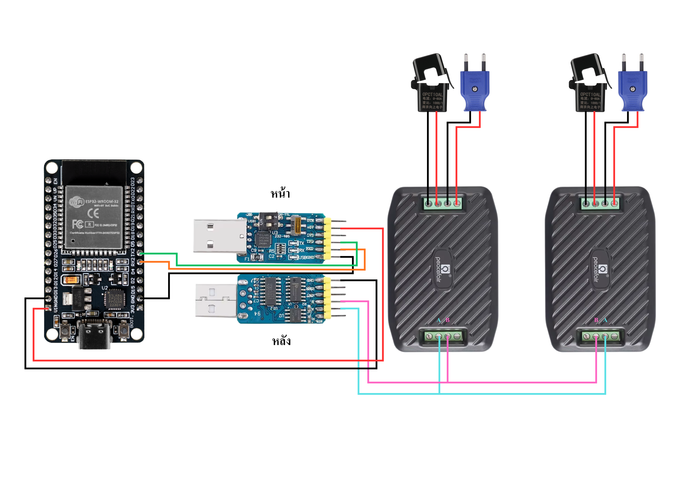

# เเผนการทำงาน

## รูปภาพการต่อวงจร

1. การต่อระหว่างบอร์ด ESP32 กับโมดูล RS485 "ด้านหน้า"
สายไฟเลี้ยง (สีแดง) ต่อจากขา VIN ของ ESP32 ไปยังขา +5V ของโมดูล
สายกราวด์ (สีดำ) ต่อจากขา GND ของ ESP32 ไปยังขา GND ของโมดูล
สายรับข้อมูล (สีส้ม): ต่อจากขา RX ของ ESP32 ไปยังขา RX ของโมดูล Rs485
สายส่งข้อมูล (สีเขียว): ต่อจากขา TX ของ ESP32 ไปยังขา TX ของโมดูล Rs485
2. การต่อระหว่างโมดูล RS485 "ด้านหลัง" กับ pzem-016
สายสัญญาณ A (สีฟ้า): ต่อออกจากขาของโมดูล ไปเข้าที่เทอร์มินอลช่อง A ของมิเตอร์ตัวที่ 1 และพ่วงสายต่อไปยังช่อง A ของมิเตอร์ตัวที่ 2
สายสัญญาณ B (สีชมพู): ต่อออกจากขาของโมดูล ไปเข้าที่เทอร์มินอลช่อง B ของมิเตอร์ตัวที่ 1 และพ่วงสายต่อไปยังช่อง B ของมิเตอร์ตัวที่ 2
3. การต่อไฟเลี้ยงเข้า pzem-016

  

ให้ยึดตามวงจรด้านหลังของตัว pzem-016 2 ช่องบน คือไฟเลี้ยงจากปลั๊ก 2 ช่องล่างคือ ช่องต่อ CT

## คำเตือน

** ห้ามต่อ RX TX สลับกันเด็ดขาด ถ้ายังงั้นตัว RS485 กับตัว ESP32 จะเเย่งกันรับเเละส่ง **

** ห้ามต่อ A กับ B สลับกันเด็ดขาด**

** CT ต้องคล้องสายไฟเพียงแค่เส้นเดียวเท่านั้น (จะคล้องสายไฟ L หรือสาย N ก็ได้) หากคล้องรวบทั้ง 2 เส้นพร้อมกัน สนามแม่เหล็กจะหักล้างกันเอง ทำให้เซ็นเซอร์อ่านค่ากระแสไฟฟ้าได้ 0 แอมป์**

## การต่อ Node red

  

ใน Function Block ให้ใส่โค๊ดที่เปะไว้ให้ ชื่อ "code in function block"
